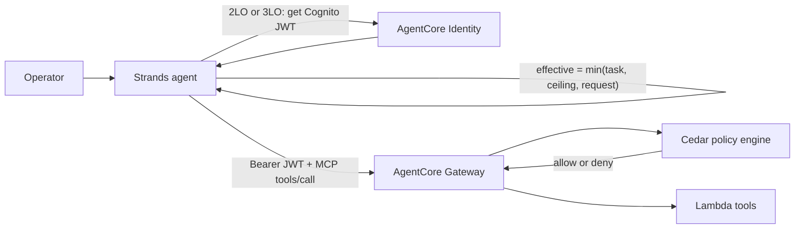

# AgentCore prototype: autonomy, Gateway, Identity, Cedar

A small TypeScript prototype of a single-purpose **data-reliability agent**. It is meant to try Amazon Bedrock AgentCore — Gateway, Identity (2LO and 3LO), and Cedar policy — and to prove a simple autonomy model for dedicated agents.

## Overview

You have small agents that each do one job, at a declared level of autonomy:

| Level | Meaning |
|---|---|
| `inform` | Report only. No fix tools. |
| `ask` | May fix, but only after a human approves (Strands interrupt). |
| `fix_notify` | Fix on its own, then notify someone. |
| `fix_log` | Fix on its own, then write a log line. |

Autonomy is **per task**, not a global switch. A short mapping table says what each task is allowed to do by default (`check_freshness` is `inform`, `rerun_stale_load` is `ask`, and so on). Each agent also has a **hard ceiling** (`agentMax`). Nobody — not a human prompt, not the agent itself — can raise that ceiling. The level that actually applies is:

```
effective = min(task level, agent ceiling, requested level if someone asked)
```

If a fix fails, or the agent cannot perform it (including a declined approval), it **downgrades** rather than retrying at the same level: `fix_*` → `ask` → `inform`.

The moving parts and what sits where:

- **The Strands agent** decides which tool to call, clipped by the effective level. Approval for `ask` is a Strands interrupt in agent code.
- **AgentCore Identity** is how the agent gets an outbound OAuth token: **2LO** (client credentials, machine-to-machine) or **3LO** (authorization code, on behalf of a signed-in user).
- **AgentCore Gateway** is the MCP front door. It checks the JWT, then offers `get_dataset_freshness` and `rerun_load` (backed by a tiny Lambda with fake warehouse data).
- **Cedar policy** (Policy in AgentCore, generally available) sits on the Gateway, *outside* the agent. It is the safeguard you cannot jailbreak from a prompt: a caller whose token only has `datarel/read` (an inform-ceiling agent) cannot run `rerun_load` at all, and nobody can rerun `payments_daily`.



What each stage proves:

- **A** — the autonomy model in agent code, including the ceiling, the interrupt for `ask`, and a failed-fix downgrade. Local, no AWS required.
- **B** — the same tools behind a Gateway, with a token minted by Identity **2LO**.
- **C** — Cedar on that Gateway: a deny you can see for `payments_daily`, and a deny for an inform-ceiling token that tries a fix.
- **D** — optional **3LO**: you sign in at Cognito hosted UI, Identity stores the user token, the script calls the Gateway on your behalf.

AgentCore Runtime (a containerized `/ping` + `/invocations` host) is sketched in `src/runtime/app.ts` but is **not** in the default CDK stack, so this prototype does not need Docker.

## Prerequisites

| What | Notes |
|---|---|
| **Node.js 22+** | `@strands-agents/sdk` requires it. `nvm use` picks up `.nvmrc`. |
| **AWS CLI + a profile** | `export AWS_PROFILE=...` and `export AWS_REGION=ap-southeast-2`. |
| **Region `ap-southeast-2`** | Gateway, Identity, and Policy in AgentCore are all available in Sydney. Stay there. |
| **IAM for Stage B–D** | Your principal needs `bedrock-agentcore:GetWorkloadAccessToken`, `GetWorkloadAccessTokenForUserId`, `GetResourceOauth2Token`, and `CompleteResourceTokenAuth`, plus the usual CDK deploy rights. `GetWorkloadAccessTokenForUserId` is the development path (the `userId` is an opaque string, not a verified end-user). Prefer JWT-based WATs in production. |
| **Stage A only** | None of the above. Just Node 22. |

Key docs:

- Autonomy interrupts: https://strandsagents.com/docs/user-guide/sdk/interrupts/
- Gateway inbound JWT: https://docs.aws.amazon.com/bedrock-agentcore/latest/devguide/gateway-inbound-auth.html
- Lambda tool event shape: https://docs.aws.amazon.com/bedrock-agentcore/latest/devguide/gateway-add-target-lambda.html
- Identity tokens (2LO / 3LO): https://docs.aws.amazon.com/bedrock-agentcore/latest/devguide/identity-authentication.html
- 3LO session binding (`CompleteResourceTokenAuth`, `allowedResourceOauth2ReturnUrls`): https://docs.aws.amazon.com/bedrock-agentcore/latest/devguide/oauth2-authorization-url-session-binding.html
- Workload access tokens: https://docs.aws.amazon.com/bedrock-agentcore/latest/devguide/get-workload-access-token.html
- Cedar (default deny, forbid overrides permit, `context.input`, JWT claims as tags): https://docs.aws.amazon.com/bedrock-agentcore/latest/devguide/policy-understanding-cedar.html, https://docs.aws.amazon.com/bedrock-agentcore/latest/devguide/example-policies-principal.html
- Policy GA (including Sydney): https://aws.amazon.com/about-aws/whats-new/2026/03/policy-amazon-bedrock-agentcore-generally-available/
- CDK L2 constructs: https://docs.aws.amazon.com/cdk/api/v2/docs/aws-cdk-lib.aws_bedrockagentcore-readme.html
- Regions: https://docs.aws.amazon.com/bedrock-agentcore/latest/devguide/agentcore-regions.html

---

## Stage A: autonomy in the agent (~20 min, no AWS)

### A.1 Install and typecheck
```bash
cd agentcore-proto
npm install
npm run typecheck
```
Expect no output from `typecheck`.

### A.2 Unit-test the level maths
```bash
npm test
```
Expect 5 passing tests: the task table, `effective = min(...)`, the ceiling that cannot be raised, and `fix_* → ask → inform`.

### A.3 Run a read-only task
```bash
npm run stage-a -- --task check_freshness --max ask
```
`check_freshness` maps to `inform`, so the effective level is `inform` even though the agent ceiling is `ask`. Expect only `get_dataset_freshness` to run, for `payments_daily`, with status `STALE`. No `rerun_load`.

### A.4 Prove the ceiling cannot be raised
```bash
npm run stage-a -- --task rerun_stale_load --max inform
```
The task maps to `ask`, but the agent max is `inform`, so effective is `inform`. Expect the same read-only behaviour: no fix tool.

### A.5 Watch a failed fix downgrade
```bash
npm run stage-a:downgrade
```
This is a locked path (no prompts, no AWS). Task `rerun_failed_load` maps to `fix_notify`; ceiling is `fix_log`, so it starts at `fix_notify`. `payments_daily`'s rerun is built to fail. Expect:

```
effective=fix_notify
NOTIFY: rerun_load {"table_name":"payments_daily"} -> {"ok":false,...,"error":"extract job returned 0 rows ..."}
Fix failed or was declined. Downgrading fix_notify → ask (no retry at fix_notify).
🚫 Tool #2: rerun_load (denied)          # auto-answered 'n' at the ask interrupt
Fix failed or was declined. Downgrading ask → inform (no retry at ask).
get_dataset_freshness ... status STALE   # report only
```

### A.6 Try `ask` yourself (optional)
```bash
npm run stage-a -- --task rerun_stale_load --max ask --table orders --approve y
```
Or omit `--approve` and type `y` or `n` when the interrupt fires. `--table orders` succeeds if you approve. Pass `--live` to use Bedrock (`au.anthropic.claude-sonnet-4-6` in `ap-southeast-2`) instead of the scripted model.

---

## Stage B: Gateway + Identity 2LO

The CDK stack is all in `ap-southeast-2`: Cognito, a Gateway, a Lambda with the two tools, Identity providers, and a workload identity.

### B.1 Bootstrap (once) and deploy
```bash
export AWS_PROFILE=<your-profile>
export AWS_REGION=ap-southeast-2
npx cdk bootstrap
npx cdk deploy --outputs-file outputs.json
```
Approve the IAM changes. Expect `AgentCoreProtoStack.GatewayUrl`, `WorkloadName`, `FixProviderName`, `InformProviderName`, and the Cognito ids in the outputs.

### B.2 Mint a 2LO token and list tools
```bash
npm run identity:2lo -- --ceiling fix
npm run gateway:call -- get_dataset_freshness payments_daily
```
The first command uses AgentCore Identity (`GetWorkloadAccessTokenForUserId` + `GetResourceOauth2Token` with `oauth2Flow=M2M`) and writes `.token`. Expect the freshness payload with `status: "STALE"`.

---

## Stage C: Cedar deny

### C.1 Allowed fix
```bash
npm run gateway:call -- rerun_load orders
```
Expect `{ "ok": true, "table": "orders", "jobId": "job-orders-..." }`.

### C.2 Denied by table
```bash
npm run gateway:call -- rerun_load payments_daily
```
Expect a failure whose message is a Cedar **deny** (the `ForbidRerunPayments` policy). The Lambda must not have run.

### C.3 Denied by agent ceiling
```bash
npm run identity:2lo -- --ceiling inform
npm run gateway:call -- rerun_load orders
```
The inform provider's token has `datarel/read` only. Expect another deny: there is no permit for `rerun_load` without `datarel/fix`. This is the ceiling enforced *outside* the agent.

---

## Stage D: 3LO (optional, needs a browser)

3LO uses AgentCore **session binding**, not just polling `GetResourceOauth2Token`. The first call returns an `authorizationUrl` (the `sessionUri` field is often absent; the session id is the `request_uri` query parameter). After you sign in, AgentCore redirects to the app's `resourceOauth2ReturnUrl` with `?session_id=...`. The local script must then call `CompleteResourceTokenAuth` with that session and the **same** `userId` used for `GetWorkloadAccessTokenForUserId`, and only then re-call `GetResourceOauth2Token` until `accessToken` is returned.

There are two different URLs. Do not mix them up:

| URL | Who uses it | Value |
|---|---|---|
| Provider callback | Cognito Hosted UI → AgentCore | `UserProviderCallbackUrl` (`https://bedrock-agentcore.../identities/oauth2/callback/<provider-id>`) |
| App return URL | AgentCore → this repo's local server | `http://localhost:9090/oauth2/callback` (`AppReturnUrl`, also on the workload identity as `allowedResourceOauth2ReturnUrls`) |

One-time setup:

1. **Redeploy this revision** (or, without a full stack update, only refresh the workload identity):
   ```bash
   npx cdk deploy --outputs-file outputs.json
   # faster alternative if you do not want a full redeploy:
   aws bedrock-agentcore-control update-workload-identity \
     --name datarel_workload \
     --allowed-resource-oauth2-return-urls \
       http://localhost:9090/oauth2/callback \
       http://127.0.0.1:9090/oauth2/callback
   ```
   The previous stack registered the *provider* callback on the workload identity, which is the wrong URL for session binding.
2. Copy `UserProviderCallbackUrl` from `outputs.json` and add it to the Cognito **UserClient** allowed callback URLs (keep every other client setting). The console is often easier than `update-user-pool-client`. Inspect first if you use the CLI:
   ```bash
   aws cognito-idp describe-user-pool-client --user-pool-id <UserPoolId> --client-id <UserClientId>
   ```
3. Create a demo user and give it a permanent password:
   ```bash
   aws cognito-idp admin-create-user --user-pool-id <UserPoolId> --username demo
   aws cognito-idp admin-set-user-password --user-pool-id <UserPoolId> --username demo --password 'Choose-a-real-one-1' --permanent
   ```

Then, from the repo (port 9090 must be free):

```bash
npm run identity:3lo
```

It starts a tiny server on `http://localhost:9090/oauth2/callback` and prints an authorization URL. Open that URL in a browser, sign in as `demo`, and wait. After the redirect, the script calls `CompleteResourceTokenAuth`, polls until Identity returns an `accessToken`, and writes `.token`. Call the Gateway the same way as in Stage B. Leave the terminal running until `.token` is written — do not open the provider callback URL yourself, and do not open a stale authorize URL from an earlier attempt.

---

## Troubleshooting

| Symptom | Fix |
|---|---|
| `Missing outputs.json` | Redeploy with `--outputs-file outputs.json`. |
| `Could not load credentials` / Identity API AccessDenied | Check `AWS_PROFILE` / SSO, and the three `GetWorkloadAccessToken*` / `GetResourceOauth2Token` actions. |
| 3LO throws `neither accessToken nor sessionUri` | Fixed in this revision: `sessionUri` is often omitted; complete the flow via the app return URL + `CompleteResourceTokenAuth`, then poll. |
| 3LO hangs after you sign in, or callback JSON says `authorizationCode` / `state` are null | Add `UserProviderCallbackUrl` to the Cognito UserClient (provider callback). Do not open that URL yourself. A null code/state is usually a Cognito error redirect or a stale/previous attempt. |
| GetResourceOauth2Token rejects the return URL | The workload identity must list `http://localhost:9090/oauth2/callback`. Redeploy, or run the `update-workload-identity` command above. |
| Cedar `like "*datarel/fix*"` surprises you | `like` is a substring match. The scope names here are distinct enough that it is fine. |
| Cognito domain already taken | The prefix is `drel` plus a short unique id. Change `domainPrefix` in `cdk/lib/stack.ts` and redeploy. |

```bash
npx cdk destroy
```

`cdk.out`, `outputs.json`, and `.token` are gitignored. Do not commit `.token`.
